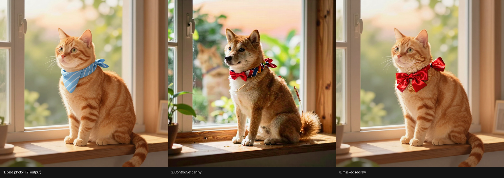

# Z-Image-Turbo 本地部署（RTX 4070 Laptop 8GB 显存版）

阿里通义 **Z-Image-Turbo** 在 **RTX 4070 Laptop · 8GB VRAM · 16GB 单通道内存** 上的
实测配置：工作流、参数、显存档位选择、提示词写法、ControlNet 与遮罩局部重绘用法。

仓库里只有配置、脚本和文档；**不含任何模型权重**（用 `scripts/fetch_weights.ps1` 拉，
脚本按精确字节数校验）。大文件一律用链接代替。

---

## 为什么这个模型值得单独一套配置

- **中文提示词原生可用**。Z-Image 的文本编码器是 **Qwen3-4B**，`CLIPLoader` 的 `type` 选
  `lumina2`，中文直接写就行——和 MiniMax-H3-Image（必须全英文）正好相反。
- **8–9 步出图**，是蒸馏过的 Turbo 版，不是 30 步慢模型。
- **Apache-2.0 许可**，商用友好，没有 MiniMax 那套地区/营收门槛。

> 仓库名叫 `Z-image-turbo-fp16`，但 Z-Image-Turbo **官方没有 fp16 版本**，
> 发布的是 bf16（另有 Comfy-Org 重打包的 int8 / nvfp4）。本仓库主推的是 **bf16 + int8** 两条路。

---

## 本机实测组件

| 组件 | 文件 | 字节数 | 位置 |
|---|---|---|---|
| DiT | `z_image_turbo_bf16.safetensors` | 12,309,866,400 | `models/diffusion_models/` |
| 文本编码器 | `qwen_3_4b.safetensors` | 8,044,982,048 | `models/text_encoders/` |
| VAE | `ae.safetensors` | 335,304,388 | `models/vae/` |
| ControlNet | `Z-Image-Turbo-Fun-Controlnet-Union-2.1-8steps.safetensors` | 6,712,485,600 | `models/model_patches/` |

三个主文件的字节数与 ModelScope `Comfy-Org/z_image_turbo` 官方仓库**完全一致**（已逐个核对）。

---

## 显存档位怎么选（8GB 机器的重点）

| 档位 | DiT | 文本编码器 | 合计 | 说明 |
|---|---|---|---|---|
| **bf16**（本机实测） | 12.31 GB | 8.04 GB | 20.35 GB | 官方原版，靠 `--lowvram` 大量卸载，最慢 |
| **int8** | 6.20 GB | 5.63 GB | 11.83 GB | **推荐**，官方模板有现成组合 |
| **nvfp4** | 4.51 GB | 3.48 GB | 7.99 GB | 显存最省，官方暂无模板，换个文件名即可 |

```powershell
# 默认 bf16
powershell -ExecutionPolicy Bypass -File scripts\fetch_weights.ps1 -Target <ComfyUI>\models
# 8GB 显卡建议改用 int8
powershell -ExecutionPolicy Bypass -File scripts\fetch_weights.ps1 -Target <ComfyUI>\models -Variant int8
# 顺带下 ControlNet（Apache-2.0，公开直链）
powershell -ExecutionPolicy Bypass -File scripts\fetch_weights.ps1 -Target <ComfyUI>\models -IncludeControlNet
```

换成 int8/nvfp4 后，工作流里把 `UNETLoader` 的 `unet_name` 和 `CLIPLoader` 的 `clip_name`
换成对应文件名即可，**其它节点一个都不用改**。

---

## 实测参数

### 四条已跑通的工作流

| 场景 | 关键节点 | KSampler | 出图 |
|---|---|---|---|
| **文生图** | `UNETLoader` + `CLIPLoader(lumina2)` + `VAELoader` + `EmptySD3LatentImage` | `euler` / `simple` / **9 steps** / **cfg 1.0** | `samples/demo_base.png` |
| **AuraFlow 文生图** | 上面 + `ModelSamplingAuraFlow(shift 3.0)` | `res_multistep` / `simple` / **8 steps** / cfg 1.0 | — |
| **ControlNet 结构控制** | 上面 + `ModelPatchLoader` + `ZImageFunControlnet` + `Canny` | `res_multistep` / `simple` / **8 steps** / cfg 1.0 | `samples/sample_controlnet_canny.png` |
| **遮罩局部重绘** | `ModelPatchLoader` + `ZImageFunControlnet(inpaint_image, mask)` + `VAEEncode` + `SetLatentNoiseMask` | `dpmpp_2m_sde_heun_gpu` / `sgm_uniform` / **9 steps** / cfg 1.0 | `samples/sample_inpaint_masked.png` |

前三行的文生图参数是从本机 39 张历史出图的 PNG 元数据反推的；后两行是本轮照着 ComfyUI
0.45.0 官方模板 + 源码重搭并实跑验证的。

**关键点：cfg 固定 1.0。** Z-Image-Turbo 是蒸馏模型，负面提示词在 cfg=1 时**不参与计算**——
但写上无害，本机那串负面词是：

```
blurry, low quality, deformed, bad anatomy, extra limbs, floating limbs,
wrong position, censored, clothes, text, watermark
```

> 那串里的 `clothes` 是当时特定用途留下的，不是通用建议；照抄会让所有图都不穿衣服。
> 通用负面词建议去掉它。

画布本机用 **1024×1024**。Z-Image-Turbo 原生支持到 2048²，8GB 机器上 1024² 最稳。

### 采样器名字订正

ComfyUI 的 KSampler 下拉里**没有 `dpmpp_2p_sde_heun`**。实际存在的是：

```
dpmpp_2m_sde_heun        dpmpp_2m_sde_heun_gpu
```

`_gpu` 变体会把模型留在显存里不来回搬。本仓库的遮罩重绘工作流用
`dpmpp_2m_sde_heun_gpu`（和本机历史出图一致）。

---

## 三种"照着图改"的用法，Z-Image 能做到哪种



*左：底图（也是文生图输出）。中：ControlNet canny —— 同一扇窗、同一姿势，把橘猫换成柴犬。
右：遮罩局部重绘 —— 只把蓝条纹围巾换成红色缎面蝴蝶结，其余像素原样保留。*

| 想要的效果 | 能做吗 | 走哪条路 |
|---|---|---|
| **结构照抄，内容重画**（换主体、保留构图） | ✅ | ControlNet：`Canny` → `ZImageFunControlnet` |
| **只改画面里的一块** | ✅ | 遮罩局部重绘：alpha 洞 + `SetLatentNoiseMask` + `ZImageFunControlnet(inpaint_image, mask)` |
| **整张照着参考图重画**（像 MiniMax-H3-Image 的图生图） | ❌ | Z-Image-Turbo 没有参考图条件通道 |

第三行为什么不行：ComfyUI 0.45.0 里能喂参考图潜变量的只有 `FluxKontextMultiReferenceLatentMethod`
（Flux Kontext 系）和 `TextEncodeZImageOmni`（Z-Image-**Omni**，另一个模型）。
Z-Image-Turbo 的 `Lumina2.extra_conds` 里的 `ref_latents` 分支没有对应的用户节点能产生。
所以"整图重绘"只能退化成上面两种。

---

## ControlNet：怎么接

用的是 **`ModelPatchLoader`**，不是 `ControlNetLoader`——它作为模型补丁挂在 DiT 上。
正确顺序：

```
UNETLoader ─┐
            ├─ ZImageFunControlnet ─ ModelSamplingAuraFlow(shift 3.0) ─ KSampler
ModelPatchLoader ─┤
VAELoader ────────┘
```

节点选 **`ZImageFunControlnet`**（`comfy_extras/nodes_model_patch.py:811`），它输出的是 **MODEL**，
不是 CONDITIONING——所以它排在 `ModelSamplingAuraFlow` 前面。

### 用法一：canny 结构控制

```
LoadImage ─ Canny ─ image ─┐
                            ├─ ZImageFunControlnet ─ ...
EmptySD3LatentImage ───────┘
```

**注意这里不要接 `VAEEncode` + `SetLatentNoiseMask`**（官方模板 `image_z_image_turbo_fun_union_controlnet.json`
也没有）。latent 用 `EmptySD3LatentImage`，输入图只作为边缘图条件。

> **canny 阈值**：官方模板用 `low 0.1 / high 0.32`。这个值在毛发主体上会把每一根毛都当成边缘，
> 模型再把它们画回黑色条纹。猫狗这类毛茸茸的主体用 **`0.25 / 0.6`** 干净很多；
> 建筑、产品这种硬边主体再调回低阈值。

### 用法二：遮罩局部重绘

```
LoadImage ─┬─ image ────────────────┐
           ├─ mask ─┬─ SetLatentNoiseMask(VAEEncode(base)) ─ latent ─ KSampler
           │        └─ mask ─────────┤
           └─ image ─ inpaint_image ─┴─ ZImageFunControlnet ─ ...
```

**遮罩怎么来的：用输入 PNG 的 alpha 通道，不要单独准备灰度遮罩图。**
ComfyUI 的 `LoadImage` 输出 `mask = 1 - alpha`：

- PNG 里 alpha = 0 的区域 → mask = 1 → **重绘区**
- PNG 里 alpha = 255 的区域 → mask = 0 → **保留区**

`mask=1` 在两个下游节点里含义一致：

- `SetLatentNoiseMask`：采样器每一步都把遮罩外的区域按原 latent 混合回去（`comfy/samplers.py:634-642`），
  所以遮罩外像素**原样保留**；
- `ZImageFunControlnet`：遮罩区的内容从 inpaint 参考图里剔除（置 0.5 灰），
  同时把 mask 通道置 1，告诉 ControlNet "这块可以自由重画"。

生成带洞的 PNG 用 `scripts/make_demo_assets.py`：

```powershell
python scripts\make_demo_assets.py --base samples\demo_base.png --out "<ComfyUI>\ComfyUI\input"
```

它会在围巾位置挖一个 alpha 洞，并输出一张洋红标注的预览图方便核对位置。

### 2.1 补丁确实带 inpaint 通道（不是猜的）

`Z-Image-Turbo-Fun-Controlnet-Union-2.1-8steps.safetensors` 里
`control_all_x_embedder.2-1.weight` 的形状是 `[3840, 132]`，而 `132 = 4 × (16 + 17)`
（patch_size² × (control_in_dim + additional_in_dim)），即 `additional_in_dim = 17 > 0`。
`comfy_extras/nodes_model_patch.py:513` 用这个值判断 `is_inpaint`，
为真时才会走上面那条 33 通道（16 控制图 + 1 遮罩 + 16 inpaint 参考）的拼接路径。

### 权重来源

- 公开仓库 `alibaba-pai/Z-Image-Turbo-Fun-Controlnet-Union`：初版 3.10 GB，公开直链，
  `fetch_weights.ps1 -IncludeControlNet` 下的是这个。
- 本机用的 `Z-Image-Turbo-Fun-Controlnet-Union-2.1-8steps.safetensors`（6.71 GB）来自
  **需要登录 HF 才能访问的 2.1 仓库**，两者**不能互换**。

---

## 快速开始

```bat
python ComfyUI\main.py --windows-standalone-build --reserve-vram 1.0 --lowvram --fast-disk --mmap-torch-files --preview-method none --port 8188
```

启动参数和 H3-Image 那套一样：`--lowvram` + `--reserve-vram 1.0` 让 12.3GB 的 DiT 能塞进
8GB 显存，`--fast-disk` + `--mmap-torch-files` 让 8GB 的 CPU 编码器靠 NVMe 分页托底。

工作流在 `workflows/`，UI 格式拖进画布即用，API 格式可直接 POST：

| 文件 | 用途 |
|---|---|
| `zimage_turbo_t2i_ui.json` | 文生图（UI） |
| `zimage_turbo_auraflow_ui.json` | AuraFlow 变体（UI） |
| `zimage_turbo_controlnet_ui.json` | ControlNet canny 结构控制（UI） |
| `zimage_turbo_inpaint_ui.json` | 遮罩局部重绘（UI） |
| `api_prompt_zimage_t2i.json` | 文生图（API） |
| `api_prompt_zimage_auraflow.json` | AuraFlow 变体（API） |
| `api_prompt_zimage_controlnet.json` | ControlNet canny 结构控制（API） |
| `api_prompt_zimage_inpaint.json` | 遮罩局部重绘（API） |

两套格式由 `scripts/make_workflows.py` **从同一份图谱生成**，脚本内部会把 UI 图谱回转成
API 再和直接生成的 API 对拍，所以两者不会走偏。

```powershell
# 重建全部工作流
python scripts\make_workflows.py
# 校验工作流（需要 ComfyUI 在跑）
python scripts\validate_workflow.py workflows\api_prompt_zimage_inpaint.json --api
# 提交并等出图
powershell -ExecutionPolicy Bypass -File scripts\run_test.ps1 -PromptFile workflows\api_prompt_zimage_t2i.json
```

---

## 提示词

Z-Image 用 Qwen3-4B 编码器，**中英文都可以**，中文尤其省事：

```
一只橘猫坐在洒满午后阳光的木质窗台上，脖子上系着一条淡蓝色条纹围巾，
窗外是虚化的绿植与暖色天空，室内静谧，柔和的自然光，细腻的毛发质感，
温暖的色调，插画风格，高细节
```

要点：

1. **把画面类型写出来**（"插画风格" / "照片" / "油画质感"）——Z-Image 对风格词敏感。
2. **主体 + 场景 + 光线 + 材质 + 风格**，一段中文比一串标签有效。
3. **分辨率和构图词**（"特写" / "全身" / "俯视"）有用。
4. 别指望它写对文字，招牌/包装上的字基本是乱码。
5. 想要干净画面时用负面词（"不要文字、不要水印"），但 cfg=1 下负面词**不参与计算**，
   真正起作用的是把"无文字/无水印"写进正面提示词的否定表达里。
6. **局部重绘时提示词仍要写全整个画面**，不要只写"把这里改成红色"——
   遮罩外的内容模型看不见，只能靠原图 latent 提供。

更多范例见 [`prompts/prompts_zimage.txt`](prompts/prompts_zimage.txt)。

---

## 已知限制与踩过的坑

1. **cfg 必须 1.0**。蒸馏模型，调高会崩。
2. **ControlNet 用 `ModelPatchLoader` + `ZImageFunControlnet`**，用 `ControlNetLoader` 接不上。
3. **遮罩全 0 = 输出等于输入原图**。这是本轮最坑的一个：`LoadImage` 的 `mask = 1 - alpha`，
   **JPEG 没有 alpha 通道 → mask 全 0** → `SetLatentNoiseMask` 让采样器每一步都把原 latent
   混合回去 → 输出就是原图的复制，看起来像"ControlNet 没生效"。
   排查时先确认 mask 不是全 0。
4. **API 提示词里连线 id 必须是字符串**。写成 `["12", 0]` 而不是 `[12, 0]`，
   否则 ComfyUI 在 `execution.py:951` 抛 `KeyError: 12`，报的还是"另一个节点"的错，很难查。
5. **8GB 显存跑 bf16 很吃力**：DiT 12.3GB + 编码器 8GB，峰值内存贴 16GB 上限。
   换 int8 档（`-Variant int8`）是最划算的一步。
6. **本机有 3 个 Z-Image 风格 LoRA 从未用过**（`XB_ZIMAGE_TURBO_CG_20` /
   `XB_ZIMAGE_TURBO_LLT_XY_20` / `XB_ZIMAGE_TURBO_MC_KTXY_15`，各 605MB，
   在 `models/loras/`）：39 张出图里**没有任何 LoRALoader 节点**，是下完没用的。
7. **文字渲染不可靠**，同 H3-Image。
8. **PowerShell 5.1 读中文 JSON 会花**：脚本里必须
   `[System.IO.File]::ReadAllText($f, [Text.Encoding]::UTF8)`，
   不能用 `Get-Content -Raw`（默认 ANSI 码页）。同理 `Invoke-RestMethod` 传中文 body
   要自己 `[Text.Encoding]::UTF8.GetBytes()`，否则模型收到一串 `??????`。
9. 模型下载走 ModelScope 直链（9–11 MB/s）；`hf-mirror` 只有 3 MB/s，别走镜像。

---

## 许可

| 模型 | 许可 |
|---|---|
| `Tongyi-MAI/Z-Image-Turbo` | Apache-2.0 |
| `Comfy-Org/z_image_turbo`（重打包） | Apache-2.0 |
| `alibaba-pai/Z-Image-Turbo-Fun-Controlnet-Union` | Apache-2.0 |

比 MiniMax-H3-Image 宽松得多：没有地区排除，没有营收门槛。
本仓库不含权重；样图均为用本仓库配置在本机生成（底图本身也是本机文生图输出），
`samples/controlnet_canny.jpg` / `controlnet_pose.jpg` 是 alibaba-pai 官方仓库的 Apache-2.0 示例图。

---

## 目录结构

```
README.md
docs/
  部署说明.md              版本/组件/启动参数/实测数据/踩坑
  提示词指南.md            Z-Image 提示词写法与参数选择
workflows/                 8 个工作流（UI + API，各 4 条路线）
scripts/
  fetch_weights.ps1        按字节数校验的权重下载（含 int8 / nvfp4 档）
  make_workflows.py        从一份图谱生成 UI + API 两套工作流（自带回转对拍）
  make_demo_assets.py      生成带 alpha 洞的遮罩输入图 + 位置预览
  validate_workflow.py     对着运行中的 ComfyUI 校验
  run_test.ps1             提交并等出图
prompts/prompts_zimage.txt 提示词范例
samples/                   本机生成的样图、底图、遮罩输入、官方示例图
```
